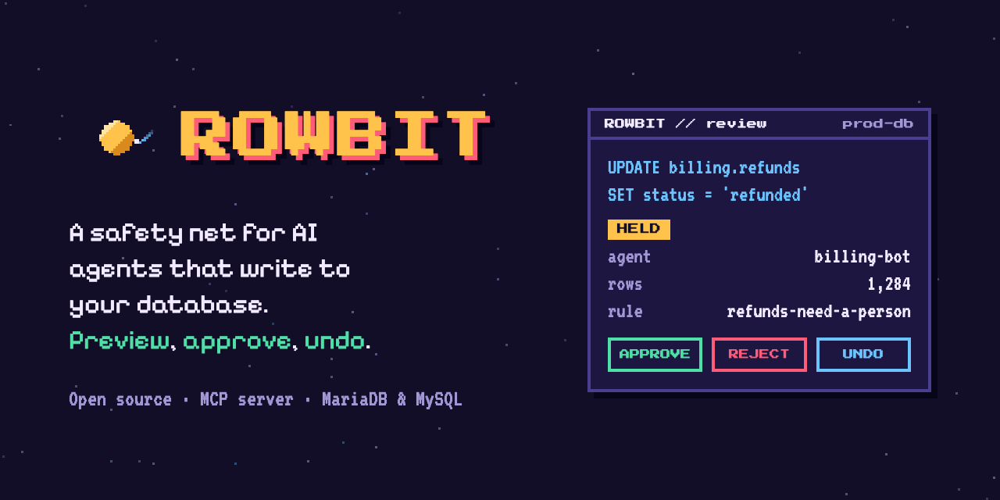

<p align="center">
  <a href="https://ermag.github.io/rowbit/"></a>
</p>

<p align="center">
  <a href="https://ermag.github.io/rowbit/"><b>Try the demo</b></a> ·
  <a href="docs/quickstart.md"><b>Quickstart</b></a> ·
  <a href="https://github.com/Ermag/rowbit/discussions/2"><b>Tell us what you think</b></a> ·
  <a href="docs/spec/change-lifecycle.md">Read the spec</a>
</p>

# Rowbit

You ask a coding agent to fix the orders stuck in pending, and it writes `UPDATE shop.orders SET status = 'cancelled' WHERE status = 'pending'`. That also matches every order placed in the last hour. Rowbit catches it before it touches a row, shows a person exactly which 1,284 rows would change, and waits. If something bad does get through, you undo that one change without restoring a backup.

**Status:** early and open source; the latest release is v0.2.0 (see the [changelog](CHANGELOG.md)). The [quickstart](docs/quickstart.md) runs Rowbit in front of a sample MariaDB database in about ten minutes, the [interactive demo](https://ermag.github.io/rowbit/) shows the idea on simulated data, and what we build first depends on what you tell us in the [feedback discussion](https://github.com/Ermag/rowbit/discussions/2).

## How it works

Rowbit sits between your agents and your database. Agents talk to Rowbit, never to the database directly.

- **Exact preview.** Rowbit reads the rows a write would change and replays it on a private temporary copy, so you see each row before and after, exactly as the table would store it. Your tables are only read.
- **Rules and humans.** A small YAML file decides whether a write is auto-approved, held for a person, or blocked. Agents can propose changes and check their status. Only people approve.
- **Apply what you approved.** If the rows changed between preview and approval, nothing is written.
- **Undo one change.** Before-images are kept per change, so you can roll back one bad write and keep everything else.
- **Scopes the database enforces.** Per agent, which tables it may read or write at all, and which tables and columns it may never read. Rowbit compiles them into native grants on a database user of the agent's own, so `SELECT *`, views and subqueries can't get around them.
- **Shadow mode.** Put an agent in front of Rowbit without slowing it down: writes the rules would hold go through, and the log says what would have happened. `rowbit policy test` replays real traffic against new rules before you enforce them.
- **Review where you are.** A web UI built into the binary, sign-in through your identity provider (OIDC), and Slack or webhook notifications when a change is held.
- **Audit log.** Every proposed write is recorded with who asked, what the rules decided, who approved it (by verified email) and what it changed, in a hash chain.

```yaml
# rowbit.yml
version: 0
agents:
  coding-agent:
    default: hold
    rules:
      - name: small-order-fixes
        when: { statement: update, table: shop.orders, columns: status, rows: { max: 20 } }
        then: allow
      - name: no-deletes
        when: { statement: delete }
        then: block
        reason: Data fixes don't delete rows.
```

Here the agent can change the `status` of up to 20 orders on its own. An update that writes any other column, or more rows, waits for a person, and deletes are refused.

See [examples/rowbit.yml](examples/rowbit.yml) and the [rowbit.yml spec](docs/spec/policy.md) for the full schema.

## Why not just migrations?

Having an agent write a migration file that goes through code review and CI is the right answer for a coding agent changing your schema, and Rowbit doesn't compete there: it holds every schema change for a person and leaves the real workflow to your migration tool. It works badly for fixing data:

- **A reviewed diff shows SQL, not rows.** `UPDATE orders SET status = 'cancelled' WHERE status = 'pending'` looks fine in review. What it touches depends on the data when it runs. Rowbit shows the exact rows when the decision is made, and refuses to apply if they changed since.
- **A one-off fix can't wait for a pull request.** Repairing a few broken rows during an incident needs an answer in minutes, and nobody writes and reviews a migration for every one.
- **Not every write needs a person.** Rules let small, safe writes straight through and hold only the risky ones, so reviewers aren't trained to rubber-stamp.
- **Undo is per change.** Down-migrations for data are usually missing or lossy. Rowbit keeps the before image of every row a change touched.

The well-known incidents of coding agents wiping production databases are a credentials problem as much as anything: take the credentials away and have the agent write migrations. Rowbit is for the agents that need to write. And if an agent does the same thing over and over, like issuing refunds, give it a tool that does just that instead of SQL.

## Good to know

- **Only Rowbit holds the database credentials.** If an agent also has its own connection string, it can write around Rowbit. Give agents Rowbit's endpoint and nothing else (over HTTP, a token of their own), and Rowbit [a database user of its own](docs/privileges.md).
- **An agent without `scopes` reads and writes with Rowbit's privileges.** Its rules still decide every write, but nothing stops it reading whatever Rowbit's user can. Give production agents scopes.
- **Undo restores rows, not the world.** It puts the data back, but it can't take back an email that was sent or a refund that was paid because of it.
- **Preview never writes to your tables.** It reads the affected rows without taking locks and replays the write on a temporary copy that only Rowbit's connection can see. Tables with triggers or cascading foreign keys are refused, because their side effects wouldn't show in the preview or be undone. So are tables Rowbit's database user can't fully inspect: it needs the `TRIGGER` and `PROCESS` privileges. See [database privileges](docs/privileges.md) for the exact grants.
- **Where data lives.** Change state, previews (including before and after copies of affected rows) and the audit log are stored in a local SQLite file next to Rowbit. Protect it like a replica of the database ([how](docs/privileges.md#the-sqlite-file)).
- **Fail closed.** Anything Rowbit can't evaluate, it refuses. See the [change lifecycle](docs/spec/change-lifecycle.md) and [SECURITY.md](SECURITY.md).

## Plan

- Rust core, Svelte review UI built into the binary.
- MCP server first, MySQL wire-protocol proxy second.
- MariaDB and MySQL first, other databases through adapters later.

## Repository layout

| Path | What |
|---|---|
| `crates/` | Rust workspace: `rowbit-core`, `rowbit-policy`, `rowbit-mysql`, `rowbit-store`, `rowbit-engine`, `rowbit-mcp`, `rowbit-web`, `rowbit-cli`. See [ARCHITECTURE.md](ARCHITECTURE.md) |
| `docs/spec/` | [Change lifecycle](docs/spec/change-lifecycle.md), [rowbit.yml](docs/spec/policy.md) and [rowbit-server.yml](docs/spec/server.md) specs |
| `docs/operating.md` | [Running Rowbit](docs/operating.md): outages, upgrades, retention |
| `examples/` | Example `rowbit.yml` and `rowbit-server.yml`, and the [quickstart](docs/quickstart.md)'s sample database |
| `web/` | The review UI's source (Svelte), built into `crates/rowbit-web/dist` |
| `compose.yaml` | MariaDB 11.4 and MySQL 8.4 for integration tests |
| `site/` | The demo page, deployed to GitHub Pages on every push to `main` |

## Contributing

Ideas and opinions are welcome in [Discussions](https://github.com/Ermag/rowbit/discussions). For code, see [CONTRIBUTING.md](CONTRIBUTING.md). Commits need a DCO sign-off (`git commit -s`). Report security issues as described in [SECURITY.md](SECURITY.md).

## License

The server is [AGPL-3.0-only](LICENSE). The `rowbit.yml` policy schema (`crates/rowbit-policy`) and future client SDKs are [Apache-2.0](crates/rowbit-policy/LICENSE).
