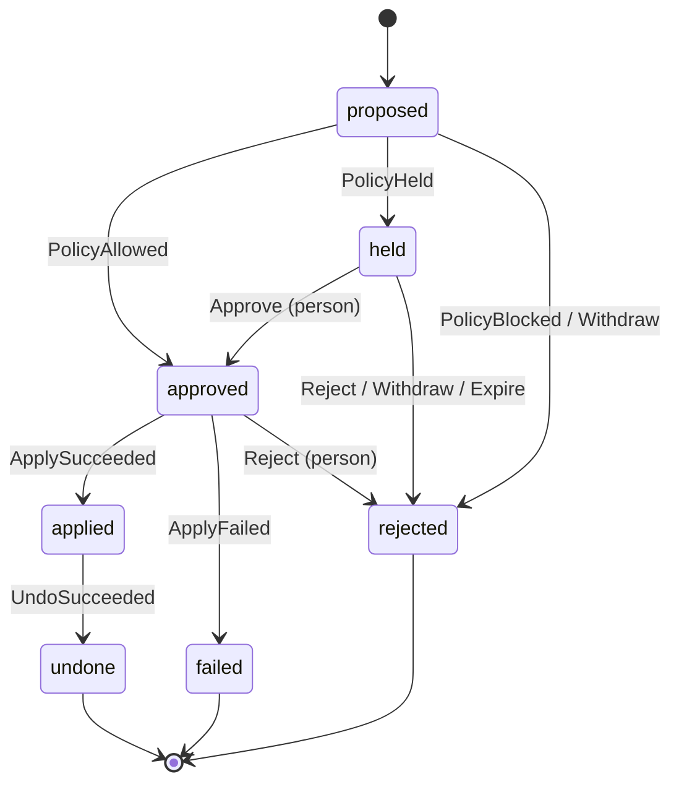

# Change lifecycle

Status: draft for v0.1. Implemented by `rowbit_core::change::transition`.

A **change** is one write an agent asked Rowbit to make. Every surface (MCP, CLI, web UI, Slack) is a thin client over the state machine below. No surface may move a change any other way.

## Principles

1. **Fail closed.** Anything not explicitly allowed is refused: an unknown state and event pair, an actor sending an event it may not send, a missing fact, a rule that cannot be evaluated, a server that cannot be reached. Refusal never writes.
2. **An agent can never approve.** Agents may propose, read status and withdraw their own change. Approval comes from a policy rule (only straight out of `proposed`) or from a person.
3. **Apply exactly the previewed rows.** What a person approves is the preview: the set of rows by primary key with their before and after images. If the database no longer matches that preview at apply time, nothing is written.

## States

| State | Meaning | Terminal |
|---|---|---|
| `proposed` | Recorded. Preview and policy not done yet. | no |
| `held` | Waiting for a person. | no |
| `approved` | Cleared to apply, by a rule or a person. | no |
| `applied` | Written to the database. Undo is possible. | no |
| `rejected` | Will never be applied. | yes |
| `failed` | Was approved, but apply was refused or failed. Nothing was written. | yes |
| `undone` | Was applied, then reversed from its before images. | yes |

A rejected or failed change is never retried in place. The agent proposes again, which creates a new change with a new preview.

## Transitions

| From | Event | To | Who may send it |
|---|---|---|---|
| `proposed` | `PolicyAllowed` | `approved` | policy |
| `proposed` | `PolicyHeld` | `held` | policy |
| `proposed` | `PolicyBlocked` | `rejected` | policy |
| `proposed` | `Withdraw` | `rejected` | the proposing agent |
| `held` | `Approve` | `approved` | a person |
| `held` | `Reject` | `rejected` | a person |
| `held` | `Withdraw` | `rejected` | the proposing agent |
| `held` | `Expire` | `rejected` | system |
| `approved` | `Reject` | `rejected` | a person |
| `approved` | `ApplySucceeded` | `applied` | system |
| `approved` | `ApplyFailed` | `failed` | system |
| `applied` | `UndoSucceeded` | `undone` | system |

Every other pair is an error. Notable consequences:

- `Approve` is only accepted from `held`, and only from a person. A person cannot approve a change that has no preview yet, and a policy rule cannot approve a held change.
- `Expire` rejects. A timeout never approves.
- A person rejecting an `approved` change is how an approval is cancelled before it applies (useful once a cool-down window exists).
- Undo is requested by a person. The system performs it and records `UndoSucceeded`. If undo is refused (see below) the change stays `applied` and the refusal is logged.

## Actors

Actors come from the transport's authentication, never from arguments an agent passes:

- `agent:<id>`: the MCP connection's or proxy user's configured agent id. Must match a key in `rowbit.yml`.
- `human:<id>`: a signed-in reviewer (CLI user in v0.1, OIDC subject from v0.2).
- `policy:<rule>`: the policy engine, naming the deciding rule, or `default` or a floor.
- `system`: Rowbit's executor and timers.

## What happens in each step

### Propose

The agent sends one SQL statement and a target database. Rowbit parses it with `sqlparser-rs` (MySQL dialect). If it is not exactly one `INSERT`, `UPDATE`, `DELETE` or DDL statement, the change is recorded and immediately `PolicyBlocked` with the parse result as the reason.

### Preview

Rowbit runs the statement inside a transaction on a dedicated connection and always rolls it back. It records:

- the target table and whether it has a primary key,
- each affected row's primary key, before image and after image,
- the columns written,
- the affected row count and any column sums the policy needs.

If the preview fails (syntax error, lock timeout, server error), the change is `PolicyBlocked`. The preview is stored with the change and a hash of it is what the reviewer approves.

### Decide

`rowbit.yml` is evaluated against the preview facts. See [policy.md](policy.md). `allow` sends `PolicyAllowed`, `hold` sends `PolicyHeld`, `block` sends `PolicyBlocked`.

### Apply

In one transaction:

1. Lock the previewed rows by primary key (`SELECT ... FOR UPDATE`).
2. Compare each to its stored before image. If any row is missing, differs, or extra rows now match, roll back and send `ApplyFailed` (reason: drift since preview).
3. Run the statement.
4. Check that the affected primary keys and their after images equal the preview. If not, roll back and send `ApplyFailed`.
5. Commit and send `ApplySucceeded`.

A server error at any point rolls back and sends `ApplyFailed`.

### Undo

In one transaction: lock the rows, check each still equals its stored after image, then restore the before images (delete inserted rows, re-insert deleted rows, write back updated columns). If any row changed since apply, roll back and refuse. The change stays `applied`; a person can resolve the conflict and try again.

## Audit log

Every transition appends one event: change id, from, to, event, actor, time, and the hash of the previous event (a hash chain, so edits to history are detectable). The preview hash is part of the `PolicyAllowed`, `PolicyHeld` and `Approve` events, so the log shows exactly what was approved.

## Not in v0.1

Multi-statement transactions as one change (v0.3), tables without a primary key, DDL previews (DDL is always held and shown as SQL), undo of an undo.
