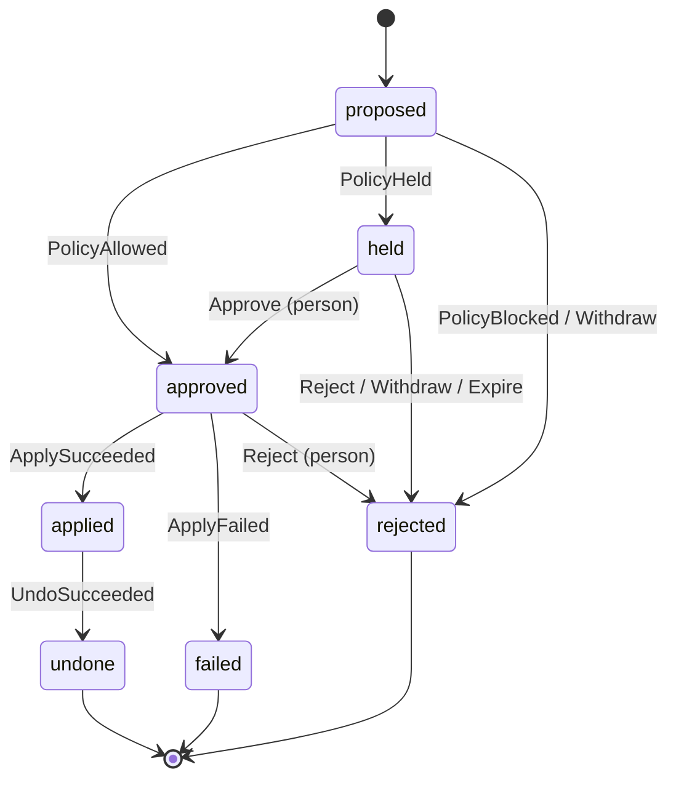

# Change lifecycle

Status: draft for v0.1. Implemented by `rowbit_core::change::transition`.

A **change** is one write an agent asked Rowbit to make. Every surface (MCP, CLI, web UI, Slack) is a thin client over the state machine below. No surface may move a change any other way.

## Principles

1. **Fail closed.** Anything not explicitly allowed is refused: an unknown state and event pair, an actor sending an event it may not send, a missing fact, a rule that cannot be evaluated, a server that cannot be reached. Refusal never writes.
2. **An agent can never approve.** Agents may propose, read status and withdraw their own change. Approval comes from a policy rule (only straight out of `proposed`) or from a person.
3. **Apply exactly the previewed rows.** What a person approves is the preview: the set of rows by primary key with their before and after images. If the database no longer matches that preview at apply time, nothing is written.

## States

| State | Meaning | Terminal |
|---|---|---|
| `proposed` | Recorded. Preview and policy not done yet. | no |
| `held` | Waiting for a person. | no |
| `approved` | Cleared to apply, by a rule or a person. | no |
| `applied` | Written to the database. Undo is possible. | no |
| `rejected` | Will never be applied. | yes |
| `failed` | Was approved, but apply was refused or failed. Nothing was written. | yes |
| `undone` | Was applied, then reversed from its before images. | yes |

A rejected or failed change is never retried in place. The agent proposes again, which creates a new change with a new preview.

## Transitions

| From | Event | To | Who may send it |
|---|---|---|---|
| `proposed` | `PolicyAllowed` | `approved` | policy |
| `proposed` | `PolicyHeld` | `held` | policy |
| `proposed` | `PolicyBlocked` | `rejected` | policy |
| `proposed` | `Withdraw` | `rejected` | the proposing agent |
| `held` | `Approve` | `approved` | a person |
| `held` | `Reject` | `rejected` | a person |
| `held` | `Withdraw` | `rejected` | the proposing agent |
| `held` | `Expire` | `rejected` | system |
| `approved` | `Reject` | `rejected` | a person |
| `approved` | `ApplySucceeded` | `applied` | system |
| `approved` | `ApplyFailed` | `failed` | system |
| `applied` | `UndoSucceeded` | `undone` | system |

Every other pair is an error. Notable consequences:

- `Approve` is only accepted from `held`, and only from a person. A person cannot approve a change that has no preview yet, and a policy rule cannot approve a held change.
- `Expire` rejects. A timeout never approves.
- A person rejecting an `approved` change is how an approval is cancelled before it applies (useful once a cool-down window exists).
- Undo is requested by a person. The system performs it and records `UndoSucceeded`. If undo is refused (see below) the change stays `applied` and the refusal is logged.

## Actors

Actors come from the transport's authentication, never from arguments an agent passes:

- `agent:<id>`: the MCP connection's or proxy user's configured agent id. Must match a key in `rowbit.yml`.
- `human:<id>`: a signed-in reviewer (CLI user in v0.1, OIDC subject from v0.2).
- `policy:<rule>`: the policy engine, naming the deciding rule, or `default` or a floor.
- `system`: Rowbit's executor and timers.

## What happens in each step

### Propose

The agent sends one SQL statement and a target database. Rowbit parses it with `sqlparser-rs` (MySQL dialect). v0.1 accepts only these shapes:

- `UPDATE t SET ... [WHERE ...] [ORDER BY ...] [LIMIT n]` on one table,
- `DELETE FROM t [WHERE ...] [ORDER BY ...] [LIMIT n]` on one table,
- `INSERT INTO t (cols) VALUES (...), ...` and `INSERT INTO t (cols) SELECT ...`,
- DDL. It is not previewed. It is always held, shown to the reviewer as SQL, run as written once approved, and cannot be undone.

Anything else is recorded and immediately `PolicyBlocked` with the reason, including: more than one statement, multi-table `UPDATE` or `DELETE`, `REPLACE`, `INSERT IGNORE`, `ON DUPLICATE KEY UPDATE`, an `UPDATE` whose `SET` reads a column assigned earlier in the same `SET` (the server evaluates those left to right, which a read cannot reproduce), and variables, locking clauses or functions with side effects anywhere in the statement.

### Preview

The preview never runs the agent's write. Rowbit derives a read from the statement and runs it on a dedicated connection as a consistent, non-locking read (`START TRANSACTION READ ONLY` with `REPEATABLE READ`), with a statement time limit. So a preview takes no row locks, fires no triggers, advances no `AUTO_INCREMENT` counter and cannot write to any table, transactional or not.

| Statement | Preview read |
|---|---|
| `UPDATE` | `SELECT` the primary key, every column, and each `SET` expression, from the table, with the statement's `WHERE`, `ORDER BY` and `LIMIT`. The `SET` results are the after images. |
| `DELETE` | `SELECT` the primary key and every column with the statement's `WHERE`, `ORDER BY` and `LIMIT`. There are no after images. |
| `INSERT ... VALUES` | `SELECT` each row of values, filled in with column defaults. There are no before images. |
| `INSERT ... SELECT` | Run the `SELECT`, filled in with column defaults. |

Before reading, Rowbit checks the target table in `information_schema` and refuses to preview (`PolicyBlocked`) when:

- the table has no primary key,
- the table's engine is not InnoDB, since apply and undo depend on rolling back,
- the table has triggers, or another table references it with `ON DELETE` or `ON UPDATE` `CASCADE` or `SET NULL` and the statement touches the referenced columns, because those effects would not appear in the preview and undo could not reverse them,
- the preview matches more rows than the configured limit (default 10,000).

It records:

- the target table, its primary key columns and its engine,
- each affected row's primary key, before image and after image,
- the columns written,
- the affected row count and any column sums the policy needs.

Values are captured as the server returns them. An after image that depends on the time or on chance (`NOW()`, `RAND()`, `UUID()`) is evaluated once, during the preview, and that value is what gets written.

If the preview fails (unsupported statement, refusal above, timeout, server error), the change is `PolicyBlocked`. The preview is stored with the change and a hash of it is what the reviewer approves.

### Decide

`rowbit.yml` is evaluated against the preview facts. See [policy.md](policy.md). `allow` sends `PolicyAllowed`, `hold` sends `PolicyHeld`, `block` sends `PolicyBlocked`.

### Apply

Apply does not run the agent's statement either. It writes the preview, row by row, by primary key. In one transaction, with a short lock wait timeout:

1. Lock the previewed rows by primary key (`SELECT ... FOR UPDATE`). For an insert whose primary key is in the preview, check that no row with that key exists yet.
2. For an update or delete, compare each locked row to its stored before image. If any row is missing or differs, roll back and send `ApplyFailed` (reason: drift since preview).
3. For an update or delete, run the preview read again without locking. If it now matches primary keys the preview did not have, roll back and send `ApplyFailed` (reason: drift since preview). Rows outside the preview are never written either way; this check makes sure nobody's approval covers a statement that now means more than they saw.
4. Write each row from its stored image: `UPDATE t SET <written columns> = <after image> WHERE <primary key> = ...`, `DELETE FROM t WHERE <primary key> = ...`, or `INSERT INTO t (...) VALUES (<after image>)`. Each write must affect exactly one row. For an insert whose primary key is assigned by `AUTO_INCREMENT`, record the key the server assigned.
5. Commit and send `ApplySucceeded`.

A server error at any point rolls back and sends `ApplyFailed`.

Locks are held only during apply, only on the previewed rows, and only for as long as it takes to write them.

### Undo

In one transaction: lock the rows by primary key, check each still equals its stored after image, then restore the before images (delete inserted rows, re-insert deleted rows, write back updated columns). If any row changed since apply, roll back and refuse. The change stays `applied`; a person can resolve the conflict and try again.

## Audit log

Every transition appends one event: change id, from, to, event, actor, time, and the hash of the previous event (a hash chain, so edits to history are detectable). The preview hash is part of the `PolicyAllowed`, `PolicyHeld` and `Approve` events, so the log shows exactly what was approved.

## Not in v0.1

Multi-statement transactions as one change (v0.3), tables without a primary key, tables that are not InnoDB, tables with triggers or cascading foreign keys, DDL previews and undo of DDL (DDL is always held and shown as SQL), undo of an undo.
