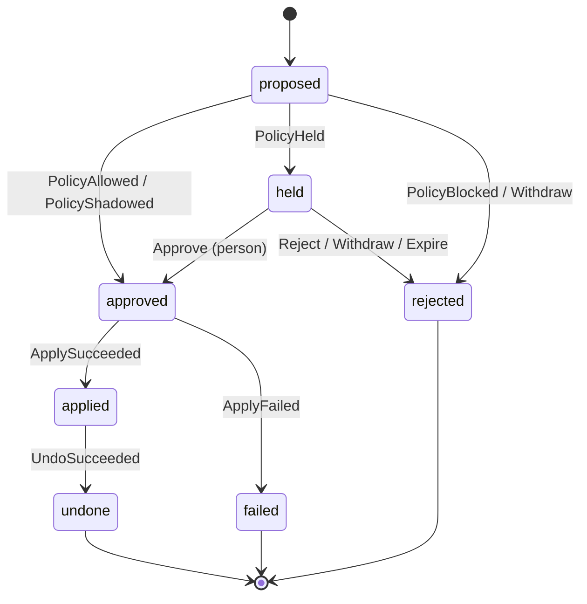

# Change lifecycle

Status: draft for v0.2. Implemented by `rowbit_core::change::transition`.

A **change** is one write an agent asked Rowbit to make. Every surface (MCP, CLI, web UI, Slack) is a thin client over the state machine below. No surface may move a change any other way.

## Principles

1. **Fail closed.** Anything not explicitly allowed is refused: an unknown state and event pair, an actor sending an event it may not send, a missing fact, a rule that cannot be evaluated, a server that cannot be reached. Refusal never writes.
2. **An agent can never approve.** Agents may propose, read status and withdraw their own change. Approval comes from a policy rule (only straight out of `proposed`) or from a person.
3. **Apply exactly the previewed rows.** What a person approves is the preview: the set of rows by primary key with their before and after images. If the database no longer matches that preview at apply time, nothing is written.

## States

| State | Meaning | Terminal |
|---|---|---|
| `proposed` | Recorded. Preview and policy not done yet. | no |
| `held` | Waiting for a person. | no |
| `approved` | Cleared to apply, by a rule or a person. | no |
| `applied` | Written to the database. Undo is possible. | no |
| `rejected` | Will never be applied. | yes |
| `failed` | Was approved, but apply was refused or failed. Nothing was written. | yes |
| `undone` | Was applied, then reversed from its before images. | yes |

A rejected or failed change is never retried in place. The agent proposes again, which creates a new change with a new preview.

## Transitions

| From | Event | To | Who may send it |
|---|---|---|---|
| `proposed` | `PolicyAllowed` | `approved` | policy |
| `proposed` | `PolicyShadowed` | `approved` | policy, for an agent in shadow mode |
| `proposed` | `PolicyHeld` | `held` | policy |
| `proposed` | `PolicyBlocked` | `rejected` | policy |
| `proposed` | `Withdraw` | `rejected` | the proposing agent |
| `held` | `Approve` | `approved` | a person |
| `held` | `Reject` | `rejected` | a person |
| `held` | `Withdraw` | `rejected` | the proposing agent |
| `held` | `Expire` | `rejected` | system |
| `approved` | `ApplySucceeded` | `applied` | system |
| `approved` | `ApplyFailed` | `failed` | system |
| `applied` | `UndoSucceeded` | `undone` | system |

Every other pair is an error. Notable consequences:

- `Approve` is only accepted from `held`, and only from a person. A person cannot approve a change that has no preview yet, and a policy rule cannot approve a held change.
- `Expire` rejects. A timeout never approves.
- An `approved` change cannot be rejected: it is applied as soon as it is approved, and a reject would race the write. A cool-down window, if one comes, will add its own state.
- Undo is requested by a person. The system performs it and records `UndoSucceeded`. If undo is refused (see below) the change stays `applied` and the refusal is logged.

## Actors

Actors come from the transport's authentication, never from arguments an agent passes:

- `agent:<id>`: the agent id from `rowbit mcp --agent`, or the agent whose token signed in over HTTP. Must match a key in `rowbit.yml`.
- `human:<id>`: a reviewer. The web UI records the verified email the identity provider (OIDC) gave at sign-in (see [server.md](server.md#signing-in)); without a provider, on a loopback address only, the name typed at sign-in behind the page's password. The CLI records `--as <name>`, or the login name, without checking it: anyone who can run `rowbit` against the store file can act as a person, so keep that file and the database credentials to reviewers.
- `policy:<rule>`: the policy engine, naming the deciding rule, or `default`, `scope` or a floor.
- `system`: Rowbit's executor and timers.

## What happens in each step

### Propose

The agent sends one SQL statement and a target database. Rowbit parses it with `sqlparser-rs` (MySQL dialect). Rowbit accepts only these shapes:

- `UPDATE t SET ... [WHERE ...] [ORDER BY ...] [LIMIT n]` on one table,
- `DELETE FROM t [WHERE ...] [ORDER BY ...] [LIMIT n]` on one table,
- `INSERT INTO t (cols) VALUES (...), ...` and `INSERT INTO t (cols) SELECT ...`,
- DDL on one table (`CREATE`, `ALTER`, `DROP`, `TRUNCATE` or `RENAME TABLE`, `CREATE INDEX`). It is not previewed. It is always held, and the reviewer approves the statement exactly as Rowbit will run it. It cannot be undone.

Anything else is recorded and immediately `PolicyBlocked` with the reason, including: more than one statement, multi-table `UPDATE` or `DELETE`, `REPLACE`, `INSERT IGNORE`, `ON DUPLICATE KEY UPDATE`, variables, placeholders, locking clauses, `SELECT ... INTO`, executable comments (`/*! ... */`), and functions outside a fixed list of built-ins (stored functions can write, and built-ins like `SLEEP` or `GET_LOCK` reach outside the statement).

Rowbit never runs the agent's text. It runs SQL printed from the parsed statement, so the statement must print back exactly as MySQL reads it: any backslash is refused (the parser and MySQL disagree on escapes such as `\%`, and printing does not escape a backslash again), and so are literals other than plain numbers, strings, hex strings, booleans and `NULL`. Every session Rowbit opens uses `NO_BACKSLASH_ESCAPES` and strict mode.

`RAND()` and `UUID()` may not appear in `WHERE` or `ORDER BY`, and `LIMIT` needs an `ORDER BY`: apply reads the filter again, and it must pick the same rows. (An `ORDER BY` with ties can still pick differently; apply then fails as drift.)

### Scope check

For an agent with `scopes` in `rowbit.yml`, before the preview: Rowbit compares every table and column the statement reads or writes with the scopes, then runs `EXPLAIN` of the canonical statement on the agent's own database user, so the database itself confirms every privilege the statement needs and runs nothing. Either refusal is `PolicyBlocked` by `policy:scope`, with the table or column (from the parser check) or the server's error code (from `EXPLAIN`). Schema changes get the parser check only, since `EXPLAIN` doesn't take them, and run on the agent's user once approved. See [Scopes](policy.md#scopes).

### Preview

The preview never runs the agent's write on the real table. On a dedicated connection, with a time limit for the whole preview:

1. Pin the clock: record `UNIX_TIMESTAMP(NOW(6))` as the preview's time, and set the session's `timestamp` to it, so `NOW()` and friends give one value throughout.
2. Check the target table (below).
3. Create a temporary table `LIKE` the target. It exists only for this connection, and `LIKE` copies the column definitions (types, defaults, generated columns, `ON UPDATE CURRENT_TIMESTAMP`) but not triggers or foreign keys.
4. Start a `READ ONLY` transaction at `READ COMMITTED`. From here the server refuses any write to a real table, and every read is a consistent read that takes no locks, including the reads an `INSERT ... SELECT` or a subquery in `SET` makes.
5. Read and replay:

| Statement | What the preview does |
|---|---|
| `UPDATE` | Read every column of the matching rows, using the statement's `WHERE`, `ORDER BY` and `LIMIT`. These are the before images. Copy them into the temporary table, run the statement's `SET` list there, and read the rows back. These are the after images. |
| `DELETE` | Read every column of the matching rows. These are the before images; there are no after images. |
| `INSERT` | Run the statement's `VALUES` or `SELECT` into the temporary table and read the rows back. These are the after images; there are no before images. A key the server will assign with `AUTO_INCREMENT` is left empty, since the temporary table's numbers mean nothing. |

Because the server itself stores each new value, the after images are exactly what the table would hold: rounded to the column's scale, in the `ENUM`'s own case, with defaults filled in, generated and `ON UPDATE` columns updated, and each `SET` evaluated left to right as MySQL does. A value that would not fit its column is an error (strict mode), not a quiet truncation. Both images hold every column, invisible ones included.

So a preview takes no row locks, fires no triggers, advances no `AUTO_INCREMENT` counter and writes to no real table, transactional or not. The temporary table is dropped with the connection.

Rowbit refuses to preview (`PolicyBlocked`) when:

- the table has no primary key, or is not an InnoDB base table (apply and undo depend on rolling back),
- the statement sets a primary key column or a generated column,
- an insert leaves out a primary key column that is not a single `AUTO_INCREMENT` key,
- the table has triggers, or another table references it with a foreign key that cascades or sets `NULL` on delete (for a `DELETE`) or on update of a column the statement sets (for an `UPDATE`), because those effects would not appear in the preview and undo could not reverse them,
- Rowbit cannot be sure of the previous point: its database user lacks `TRIGGER` on the table (without it, MySQL hides the table's triggers), or lacks `PROCESS` (needed to read InnoDB's list of every foreign key, including those on tables the user cannot see),
- the write matches more rows than the configured limit (default 10,000),
- the preview fails in any other way: a time-out, a strict-mode error, a server error.

Rowbit's database user therefore needs `SELECT`, `INSERT`, `UPDATE`, `DELETE`, `CREATE TEMPORARY TABLES` and `TRIGGER` on the databases agents write to, and the global `PROCESS` privilege.

The preview records the target table with its columns (name, type, generated, auto-increment) and primary key, the columns the statement names, each row's before and after images, and the preview's time. It is stored with the change, and its hash is what the reviewer approves.

The preview runs with Rowbit's privileges, so it can show values from any table Rowbit's user can read (a subquery in `SET`, for example). Reviewers see those values. The agent never does: it is told a change's state, table, row count and reason, never preview values. Reasons the agent sees are written by Rowbit: a database error is reduced to its code (`preview failed: database error 1366`), because server messages quote values, and the full message is logged for people as an `ErrorDetail` event. A statement can still learn about a table through how many rows it matches; for a scoped agent, the scope check has already refused any table it may not read.

### Decide

`rowbit.yml` is evaluated against the preview facts. See [policy.md](policy.md). `allow` sends `PolicyAllowed`, `hold` sends `PolicyHeld`, `block` sends `PolicyBlocked`. The event's actor is `policy:<rule>` for the deciding rule, or `policy:default` when no rule matched. `PolicyHeld` and `PolicyBlocked` carry the rule's `reason` (or which rule decided, if it has none), which the agent is shown.

When a change is held, Rowbit queues a notification for each matching target in `rowbit-server.yml` (see [Notifications](server.md#notifications)). Delivering it never changes the change.

A change outside the agent's scopes is `PolicyBlocked` by `policy:scope`. A change that fails before policy can decide is `PolicyBlocked` by `policy:floor` with the reason: an agent not listed in `rowbit.yml` (its statement is not even previewed), a statement Rowbit refuses, a preview that fails or is refused, or a write that matches no rows. What was reviewed is stored for blocked changes too, so the log shows what was refused.

### Shadow mode

For an agent with `mode: shadow`, a decision of `hold` or `block` from a rule or the agent's default is recorded instead of enforced: Rowbit sends `PolicyShadowed`, whose detail names the decision it replaced and the rule's reason (`would hold: Large or unusual refund batches are reviewed by billing.`), and whose actor is `policy:<rule>` as usual. It moves the change to `approved` and carries the review hash like `PolicyAllowed`, and the change is applied right away. The agent is told `applied`, with no reason.

Only rule decisions about row writes are shadowed. `policy:floor` and `policy:scope` still block, and schema changes are never shadowed: their rules are enforced and they are at least held, since none of those can be applied safely or undone. A shadowed change can be undone like any other.

### Apply

Apply does not run the agent's statement either. It writes the stored after images, row by row, by primary key. In one transaction, in strict mode, with a short lock wait timeout:

1. Lock the previewed rows by primary key (`SELECT ... FOR UPDATE`). For an insert whose primary key is in the preview, check that no row with that key exists yet.
2. For an update or delete, compare each locked row to its stored before image. If any row is missing or differs, roll back and send `ApplyFailed` (reason: drift since preview).
3. For an update or delete, run the preview's read again without locking, with the session's `timestamp` set to the preview's time so `NOW()` means what it meant then. If it now matches primary keys the preview did not have, roll back and send `ApplyFailed` (reason: drift since preview). Rows outside the preview are never written either way; this check makes sure nobody's approval covers a statement that now means more than they saw.
4. Write each row from its after image, setting every column that is not generated: `UPDATE t SET ... WHERE <primary key> = ...` for the columns whose after image differs from the before image (an `ON UPDATE` column is set explicitly, so it holds the previewed value), `DELETE FROM t WHERE <primary key> = ...`, or `INSERT INTO t (...) VALUES (...)`, leaving out a key the server assigns. Each write must affect exactly one row. Record the key the server assigned.
5. Read the written rows back and compare them to the after images. If any differs, roll back and send `ApplyFailed`.
6. Commit and send `ApplySucceeded`. Its detail is the hash of the apply record: the primary key of every row written, including keys the server assigned. Undo finds the rows by these keys.

A server error at any point rolls back and sends `ApplyFailed`.

For a scoped agent, before step 1, apply runs the scope check's `EXPLAIN` again on the agent's user. If the database now refuses it, apply sends `ApplyFailed` (reason: outside the agent's scope) and writes nothing.

A change approved by policy is applied right away; a change a person approves is applied when they approve it. Only one apply or undo runs for a change at a time. The `ApplyFailed` reason the agent sees names the kind of failure without row keys or values (`drift since preview: a previewed row changed`); the full message is logged for people as an `ErrorDetail` event.

Before writing, Rowbit logs an `ApplyStarted` event that leaves the state unchanged. If Rowbit stops between the database's commit and recording the outcome, or the outcome is unknown (the commit failed, or apply ran past its time limit of one minute), the change stays `approved` with `ApplyStarted` as its last event. Rowbit lists such changes on startup for a person to compare with the preview; it never retries them on its own. Undo works the same way with `UndoStarted`.

DDL runs with a short metadata lock wait, so a schema change stuck behind a long transaction fails instead of queueing every query on the table behind it. A failed DDL statement is treated as an unknown outcome, since some DDL changes the schema before failing, except a missing privilege, which the server checks before it starts: that is a plain `ApplyFailed`.

Locks are held only during apply, only on the previewed rows, and only for as long as it takes to write them.

DDL is run as the reviewed statement, after approval, and is not checked or undone. For a scoped agent it runs on the agent's database user, so the database enforces `scopes.ddl`.

### Undo

In one transaction: lock the rows by primary key and check each still equals its after image (every column, generated ones included). Then restore the before images: delete inserted rows, re-insert deleted rows, and write back the columns apply wrote. Generated columns are never written; the server recomputes them. Read every row back and compare it to its before image. If any row changed since apply, or a restored row does not read back as its before image, roll back and refuse. The change stays `applied`, and the refusal is logged as an `UndoRefused` event that leaves the state unchanged; a person can resolve the conflict and try again. Schema changes cannot be undone.

## Agent tools (MCP)

`rowbit mcp --agent <id>` serves one agent over MCP on stdin and stdout; the agent id comes from that flag, set by whoever configures the MCP client. `rowbit serve` can also serve agents over HTTP at `/mcp`, each signing in with its own token (see [MCP over HTTP](server.md#mcp-over-http)); the agent id comes from the token. Never from tool arguments. An agent gets four tools and nothing else:

| Tool | Does | Returns |
|---|---|---|
| `query` | Runs one `SELECT` that passes the same checks as a write, in a read-only transaction, with a time limit and at most 1,000 rows. Only agents listed in `rowbit.yml` may read. A scoped agent's read is checked against its scopes and runs on its own database user. Not logged as a change. | Columns, rows, and whether rows were cut off. A refused read gets Rowbit's reason; a failed one gets the server's message (`database error: ERROR 1146 ...`), which is about the agent's own read. |
| `describe_schema` | Lists the tables the agent may use, from Rowbit's own reading of the schema. For a scoped agent, only tables in its scopes, without denied tables and columns; for an agent without scopes, the tables in its default database. | Per table: its columns (name, type, nullable, part of the primary key) and what the agent may do with it (`read`, `insert`, `update`, `delete`, `ddl`). |
| `propose_write` | Proposes one statement: propose, scope check, preview, decide, and apply if allowed. | The change's id, state, table, row count and reason. |
| `change_status` | Looks up one of the agent's own changes. Another agent's change is reported as not found. | The same as `propose_write`. |

No statement, read or write, may name the server's own schemas (`information_schema`, `performance_schema`, `mysql`, `sys`), and none of them may be the default database: with the `PROCESS` grant Rowbit needs, they show every session's running SQL on the server. There is no tool to approve, reject, apply or undo. Nothing a tool returns about a change includes preview values (see Preview). An agent without `scopes` reads with Rowbit's database privileges, as in v0.1, so it can read whatever Rowbit's user can.

## Reviewing (CLI)

`rowbit changes [--state held] [--shadowed]` lists changes. `rowbit show <id>` prints the statement as Rowbit understood it (comments dropped), every row's changed columns before and after (the first 50 rows, or all with `--all`), the history and the review hash. Everything the agent or the database controls is printed with control characters and invisible or direction-changing Unicode shown as `\u{..}`, so an agent can't recolour, hide or move text in the reviewer's terminal.

`rowbit approve <id> --review <hash>` needs at least the first 12 characters of that hash, so a person approves what they looked at; the change is then applied. A change of more than 50 rows also needs `--rows <count>` with its exact row count, so an approval never covers rows the person didn't know about. `rowbit reject <id> --reason <text>`, `rowbit undo <id>` and `rowbit verify` (the audit log check) complete the set.

## Reviewing (web UI)

`rowbit serve` serves the web UI, bundled in the binary, on `127.0.0.1:8080` by default. Reviewers sign in as [server.md](server.md#signing-in) describes. It has:

- **Held**: the queue, oldest first, each with its agent, table, row count, the rule that held it and how long it has waited.
- **Change**: the statement as Rowbit will treat it, without the agent's comments; every row's changed columns before and after, paged, with unchanged columns on request; the history; and approve, reject (with a reason) and undo. The approve button names how many rows it applies ("Approve and apply all 1,284 rows") and sends the review hash of what is on screen. Above 50 rows the reviewer also types the row count, as on the CLI.
- **Log**: every change, filtered by state, agent, table or rule, with the audit log's verification status.
- **Shadow**: changes from agents in shadow mode that the rules would have held or blocked, grouped by rule.
- **Deliveries**: notifications sent and whether they arrived.

The UI is a Svelte app the binary serves from memory, talking to a JSON API under `/api` behind the same session. Every request that changes something needs the session cookie and the session's token in a header, so being able to reach the port, as any local user or agent can, is not enough. The server answers only requests addressed to its host (against DNS rebinding) and refuses requests from another origin. The content security policy allows scripts and styles from Rowbit's own origin only, with no inline scripts and no `eval`.

Values are shown so one can't pass for another: text in quotes, numbers plain, SQL `NULL` marked apart from the text `'NULL'`, binary as hex. Control characters and invisible or direction-changing Unicode in anything the agent or the database controls are made visible. The API sends values typed and the UI only ever inserts them as text, never as HTML.

## Audit log

Every transition appends one event: sequence number, change id, from, to, event, detail (the reason, if the event has one), actor, time, and the hash of the previous event. The event's own hash is SHA-256 over all of that, so the events form a chain and editing or deleting one breaks it. Proposing a change appends a first `Proposed` event whose detail records the target database and the statement exactly as the agent sent it.

The state change and its event are written in one SQLite transaction, so the state and the log can never disagree. The SQLite file is shared by the server and the CLI; each waits up to five seconds for the other's write.

What a person reviews is stored once, as canonical JSON, and never replaced: the preview for an `INSERT`, `UPDATE` or `DELETE`, and for DDL the statement as Rowbit will run it. Its hash (SHA-256 of that JSON) is part of the `PolicyAllowed`, `PolicyHeld` and `Approve` events, so the log shows exactly what was approved. `Approve` must carry the hash the person reviewed, and is refused if it differs from the stored one. `PolicyAllowed` and `PolicyHeld` are refused for a change with nothing to review.

Verifying the log checks every event's hash and link, that every event belongs to a change, every stored review against its hash and against the hashes its events name, every change's agent, database and statement against its `Proposed` event, every apply record against the hash its `ApplySucceeded` event names, and every change's state against its last event. A chain kept in the same file cannot show that its newest events were cut off along with the matching states; that needs the latest hash kept somewhere outside Rowbit, which Rowbit does not do yet.

## Not in v0.2

Approving from Slack or another chat tool (the web UI does it, behind sign-in), signing agents in with OAuth, identity providers that don't send `email_verified`, multi-statement transactions as one change (v0.3), budgets across changes (v0.3: until then a size rule such as `rows: { max: 50 }` can be met by splitting a write into smaller changes, each previewed, checked and logged on its own), tables without a primary key, tables that are not InnoDB, tables with triggers or cascading foreign keys, updates to primary key columns, DDL previews and undo of DDL (DDL is always held and shown as SQL), undo of an undo.
